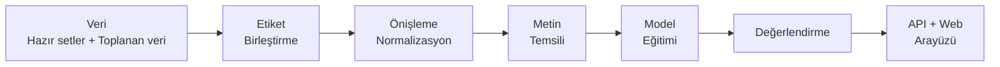
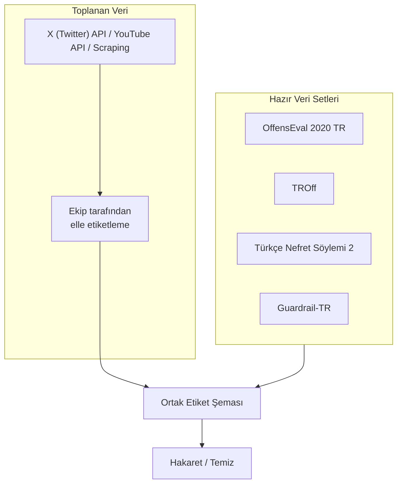
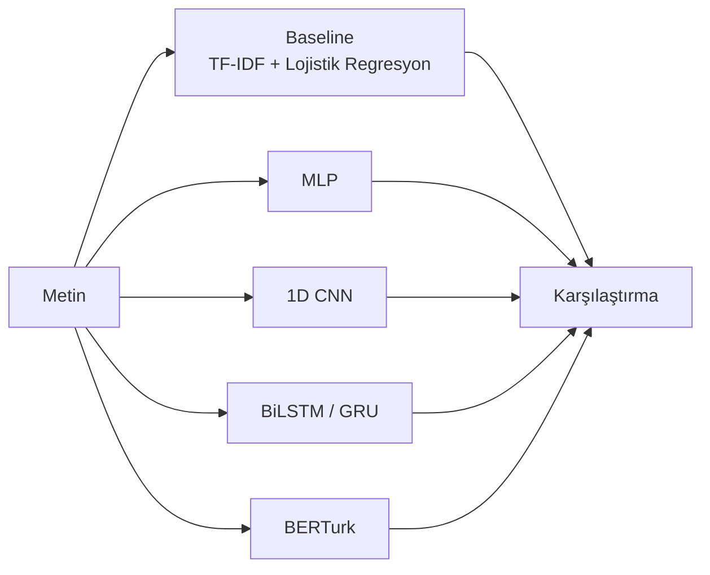
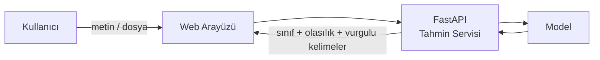

# Türkçe Saldırgan Dil Tespiti

**Sosyal medya metinlerinde Türkçe hakaret tespiti: TCK 125 bağlamında ön inceleme ve içerik moderasyonu prototipi**

---

## Proje Hakkında

Türkçe bir metnin (gönderi, yorum, mesaj) **hakaret** içerip içermediğini tahmin eden, platformdan bağımsız bir sınıflandırma sistemi. Her metin için sınıf, olasılık değeri ve karara etki eden kelimeler gösterilir.

| Sınıf | Tanım |
|---|---|
| **Hakaret** | Belirli bir kişiye yönelik onur kırıcı, aşağılayıcı ifadeler |
| **Temiz** | Hakaret veya saldırgan unsur içermeyen metinler |

> **Uyarı:** Bu sistem bir **karar destek aracıdır**. Çıktısı hukuki değerlendirme yerine geçmez; yalnızca *hakaret unsuru taşıma olasılığını* gösterir. Suç olup olmadığına yargı makamları karar verir.

---

## Uçtan Uca Akış

---

## Veri

- Veri toplamada platformların kullanım koşullarına uyulur, yalnızca herkese açık içerik alınır.
- Kullanıcı adı, profil bilgisi ve kişisel veri **tutulmaz**.

**Önişleme:** URL ve @kullanıcı temizliği, Türkçe kurallara uygun küçük harfe çevirme (İ/ı), uzatılmış harflerin kısaltılması, gizlenmiş küfür yazımlarının normalizasyonu, tekrar eden kayıtların silinmesi.

---

## Modeller

**Ana metrik:** Macro F1. Ayrıca Precision, Recall, Hakaret sınıfı F1, ROC-AUC / PR-AUC ve karışıklık matrisi raporlanır.

---

## Uygulama Mimarisi

**Ekranlar:** Metin Analizi, Toplu Analiz, Model Karşılaştırma, Hakkında / Uyarı

Yalnızca Türkçe metinler desteklenir. Sistem platformları otomatik taramaz, girilen metinler saklanmaz.

---

## Ekip

| Üye | Birincil Odak |
|---|---|
| **Aslı Gonca** | API, web arayüzü, açıklanabilirlik, deploy, model eğitimi |
| **Berkay Gündoğan** | Model eğitimi, hiperparametre optimizasyonu, karşılaştırma, hata analizi |
| **Doğan Orhun Tokdemir** | Veri toplama, etiketleme, önişleme, etiket birleştirme |

---

## Kaynaklar

1. [OffensEval 2020 – Türkçe (SemEval-2020 Task 12)](https://offenseval2020-tr.echo.directory/)
2. [Çöltekin (2020) – A Corpus of Turkish Offensive Language on Social Media](https://coltekin.github.io/offensive-turkish/)
3. [Mayda vd. – Türkçe Nefret Söylemi Veri Seti 2](https://github.com/imayda/turkish-hate-speech-dataset-2)
4. [Mayda, Diri, Dalyan (2021) – Türkçe Tweetler Üzerinde Nefret Söylemi Tespiti](https://dergipark.org.tr/tr/download/article-file/1664504)
5. [Guardrail-TR (YTÜ-CE-COSMOS)](https://huggingface.co/datasets/ytu-ce-cosmos/guardrail-tr)
6. [Şeker vd. (2025) – HATECAT-TR, Findings of EMNLP 2025](https://aclanthology.org/2025.findings-emnlp.1393.pdf)

